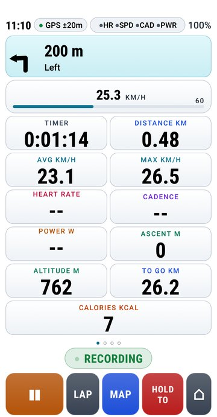
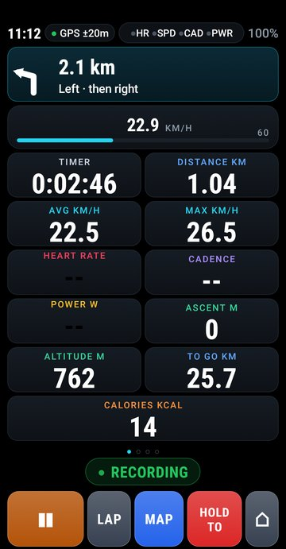
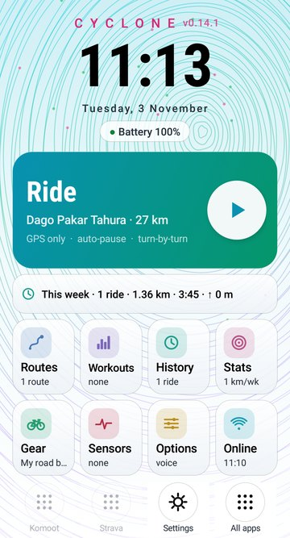
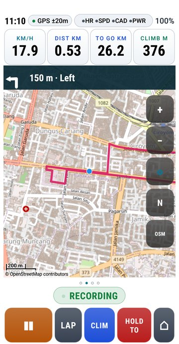
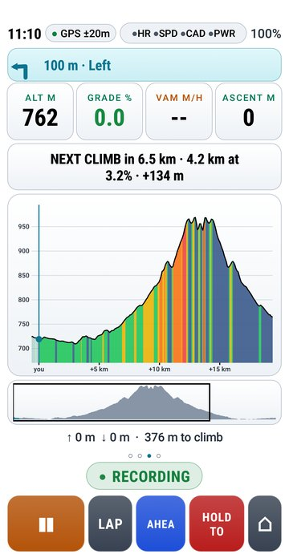
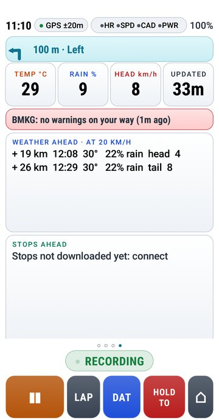
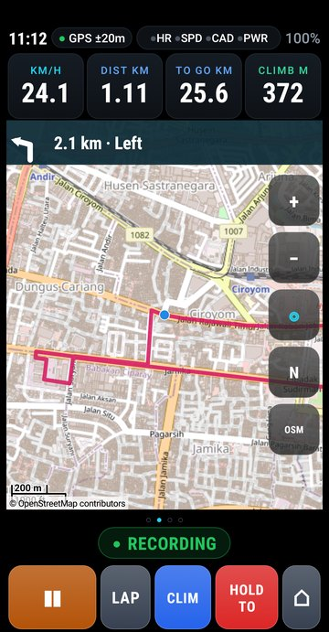
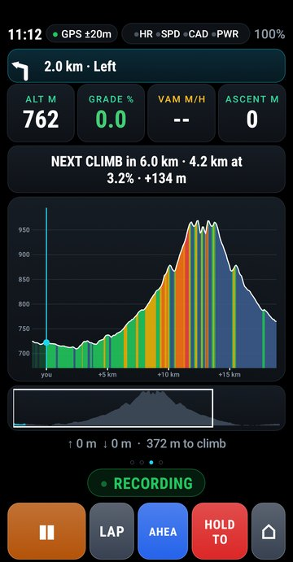
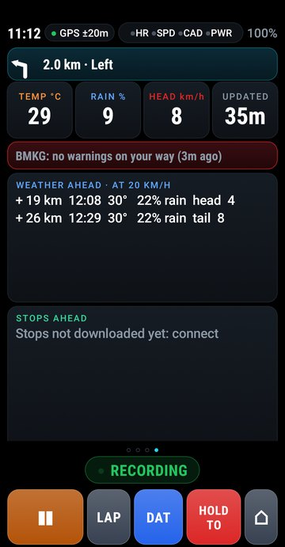
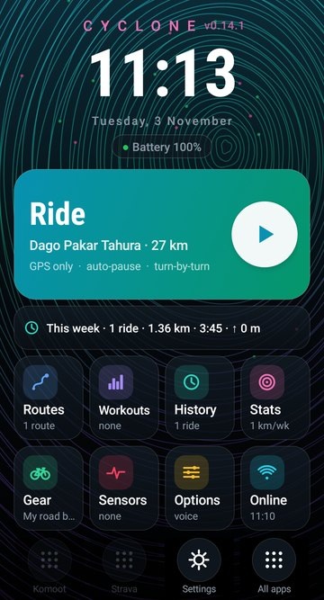

# Cyclone

**A bike computer for any Android phone.** 
Big numbers, offline maps, turn-by-turn, climbs, ANT+ and Bluetooth sensors, and rides you can send to Strava.

### ⬇ [Download Cyclone](https://github.com/zakusworo/cyclone-beta/releases/latest/download/cyclone.apk)

Free beta · no account · no ads · about 3 MB

&nbsp;
&nbsp;

## What's new in 0.14.1

- **Day and night colours.** Black on white for riding in the sun, white on black after dark. **Auto** switches at sunrise and sunset where you are.
- **Distance without a speed sensor is right now.** Cyclone follows your GPS track instead of adding up the phone's speed, which read about 10 % short. Next to a Coros Nomad: 7.30 km against 7.55 km (the Coros started a little earlier).
- **Speed like Strava.** GPS jumps are filtered out, and speed is worked out the same way Strava draws it, so the numbers match afterwards.
- **No more 0 m elevation on Strava** for phones without a barometer: Cyclone adds the altitude from terrain data before the ride goes out.

All versions: [CHANGELOG.md](CHANGELOG.md)

## Get started

1. **Download** [`cyclone.apk`](https://github.com/zakusworo/cyclone-beta/releases/latest/download/cyclone.apk) on the phone, wait until it has finished, and open it. Android asks once to allow installing apps from your browser.
2. **Open Cyclone** and allow location (and **Nearby devices** if you use Bluetooth sensors).
3. **Get the map for your area:** Options → Offline maps → **Find maps for my location**. Pick the smallest map that covers where you ride; Wi-Fi recommended.
4. **Keep the recording steady:** Options → This phone → turn battery optimisation **off** for Cyclone. Otherwise Android may thin out the recording while the screen is off.
5. **Ride:** tap the big **Ride** card, then **► Start** (or press Vol+).

Already have Cyclone? You don't need to download again: the app tells you when a new version is out.

<b>"There was a problem parsing the package"</b>

The download is incomplete. Delete it and download again, on Wi-Fi if you can. On the [Releases](https://github.com/zakusworo/cyclone-beta/releases/latest) page, take `cyclone.apk`, not "Source code".

## What it does

| Feature | What you get |
|---|---|
| 🚴 **Ride screen** | Speed, time, distance, averages, heart rate, cadence, power, altitude, calories. Four pages (data, map, climb, ahead) switched with a button or the volume keys, so it works with gloves. |
| 🌗 **Day and night** | Black on white in the sun, white on black after dark. Auto by sunrise and sunset, or pick one in Options. Tap the clock on the ride screen to change it while riding. |
| 🗺️ **Maps and routes** | Offline maps for your area. Routes from Google Maps (share the link to Cyclone), GPX, KML or KMZ. Turn-by-turn with street names, an off-course alarm, and the way back worked out offline. |
| ⛰️ **Climbs** | The climb profile coloured by gradient, the next climb on your route, and metres left to the top. Without a route, the climb you are on. |
| 📡 **Sensors** | Bluetooth heart rate, speed, cadence and power on any phone. ANT+ too on phones that have it (many Samsungs). Each bike keeps its own tyre size and sensors. |
| 🏋️ **Training** | Heart rate and power zones, structured workouts (.zwo files or from Intervals.icu), auto-lap, eat and drink reminders, spoken cues. |
| 🌦️ **Ahead** | Weather along your route, BMKG weather warnings (Indonesia) and stops ahead: water, minimarkets, fuel, toilets, mosques, bike shops, medical help. |
| 📊 **After the ride** | Summary with charts, climbs and best efforts; history, personal records, weekly goals and streaks. Rides are saved as .fit files for Strava, Intervals.icu, Garmin Connect or Komoot. |
| 🆘 **Safety** | Crash detection: after a hard fall and no movement, a message with your location goes to your contact (via ntfy or Telegram) unless you press I'M OK. |

<b>More screenshots</b>

 

| Map | Climb | Ahead |
|:---:|:---:|:---:|
|  |  |  |
|  |  |  |

How to use every screen: **[TUTORIAL.md](TUTORIAL.md)**

## Questions

<b>How do I get my rides on Strava?</b>

After a ride, tap **Strava (web)** on the summary (or in Online → your rides). Cyclone saves the ride into **Download/Cyclone** and opens Strava's upload page in your browser: tap **Choose Files** and pick it. Strava's own app can't upload files, which is why this goes through the browser.

**Intervals.icu** uploads by itself: paste your free API key and athlete ID in Online. If you have your own Strava API app, Online can upload to Strava by itself too.

<b>Why is my distance different from my watch or bike computer?</b>

A phone's GPS is not as good as a dedicated unit's, and every device smooths its track in its own way, so a difference of 2–3 % is normal. Before 0.14.1 Cyclone read about 10 % short without a speed sensor; that is fixed. For the most exact distance, pair a wheel speed sensor and set your tyre size in Gear.

<b>Why did Strava show 0 m elevation?</b>

Phones without a barometer (an air-pressure sensor) measure height with GPS, and some phones give no usable height at all. From 0.14.1, a ride recorded without altitude gets it from terrain data (Open-Meteo) as soon as the phone is online, before it goes to Strava. The ride summary shows where the altitude came from.

<b>Does it need internet?</b>

No, not while riding: GPS works without mobile data, and with the offline map and routing data for your area (downloaded once, on Wi-Fi) maps, routes and the way back all work offline. Weather, warnings, stops and uploads update whenever the phone is online.

<b>How much battery does it use?</b>

On a test ride a Poco X3 used about 5 % in 80 minutes with the screen on. For long days, turn on **Options → Ride options → Battery saver while riding** (dimmer screen that may turn off, GPS every 2 seconds) and bring a power bank.

<b>Can I read it in bright sun?</b>

Yes: the day colours (black on white) are made for that, and Auto switches to them at sunrise. Turn the phone's brightness up too; Cyclone keeps the screen on while you ride.

<b>What happens to my data?</b>

Rides stay on your phone. Nothing is uploaded unless you connect Strava or Intervals.icu, press Strava (web), send a problem report, or a crash alert goes to your contact. Weather, warnings, stops and terrain heights come from free public services (Open-Meteo, BMKG, OpenStreetMap), which get the route or your position to answer. No account, no ads, no tracking.

<b>Which phones work?</b>

Any phone with Android 8.0 or newer and GPS. A phone with a barometer gives the smoothest altitude. ANT+ sensors need a phone with ANT+; Bluetooth sensors work on any phone.

## Updates

Cyclone checks for a new beta twice a day and shows a notification when one is out. Tap it to download and install (Android asks you to confirm). You can also check in **Options → Beta & updates**. Your rides and settings are kept.

## Found a problem?

**Cyclone closed by itself or froze?** Go to **Options → Beta & updates → Send problem report**, or tap the "Cyclone closed unexpectedly" notification. Your e-mail app opens addressed to Cyclone support (cyclonebikeco@gmail.com) with the report attached; press Send. The report holds Cyclone's own log, the phone model, the app version and the active route's name, not your rides.

For anything else, open an [issue](https://github.com/zakusworo/cyclone-beta/issues/new). Say what you did, what happened and what you expected. **Options → Beta & updates → Copy phone details** gives the app version, phone model and Android version to paste in. A ride's .fit file helps a lot: open the ride in History, tap **Strava (web)**, and attach the copy it saves in Download/Cyclone.

---

This repository hands out the beta builds; the app's source code is not here. 
Maps: © OpenStreetMap contributors, built by the [Mapsforge](https://github.com/mapsforge/mapsforge) project. Bike routing: the [BRouter](https://github.com/abrensch/brouter) engine (MIT licence) with routing data from brouter.de. Weather and terrain heights: [Open-Meteo](https://open-meteo.com). Weather warnings: BMKG.
