# How to use Cyclone

This guide walks you through Cyclone from installing it to looking at your ride afterwards. You don't need
an account, and most things work without internet.

Screenshots come from a test phone running Android 8.0 and Cyclone 0.14.4, so your phone may look a little
different. Sections marked **(from 0.14.0)** or **(from 0.14.1)** describe features that arrive in that version.

**Contents**

1. [Install and first start](#1-install-and-first-start)
2. [The home screen](#2-the-home-screen)
3. [Offline map for your area](#3-offline-map-for-your-area)
4. [Pairing sensors](#4-pairing-sensors)
5. [Riding](#5-riding)
6. [Routes](#6-routes)
7. [Workouts](#7-workouts)
8. [After the ride](#8-after-the-ride)
9. [Gear (from 0.14.0)](#9-gear-from-0140)
10. [Stats & goals (from 0.14.0)](#10-stats--goals-from-0140)
11. [Options worth knowing](#11-options-worth-knowing)
12. [Updates and problem reports](#12-updates-and-problem-reports)
13. [Troubleshooting](#13-troubleshooting)

---

## 1. Install and first start

1. Open this link on the phone:
   **https://github.com/zakusworo/cyclone-beta/releases/latest/download/cyclone.apk**
   It always points to the newest version (about 3 MB).
2. Wait until the download has finished, then open the file.
3. Android asks once whether your browser may install apps. Allow it, go back and tap **Install**.
4. Open Cyclone. Allow **location**. On Android 13 and newer it also asks for **notifications**. Allow
   that too, because the ride and update notices use it.
5. The first time, Cyclone offers to find an **Offline map** for where you are. Tap **Find my map**, or
   **Not now** to do it later (see [section 3](#3-offline-map-for-your-area)).

### Stop Android from cutting your recording

With the screen off, Android may slow Cyclone down to save battery, and your recording gets gaps. Do this once:

1. On the home screen, tap **Options**.
2. Under **This phone**, tap **Battery optimisation: on · tap to exempt Cyclone** and allow it.
   The button then reads **Battery optimisation: off for Cyclone ✓**.
3. Some brands have a second switch of their own. Look in the phone's settings for Cyclone and choose:
   Xiaomi **No restrictions**, Samsung **Unrestricted** (or add Cyclone to the never-sleeping apps),
   Oppo/Realme **Allow background activity**.

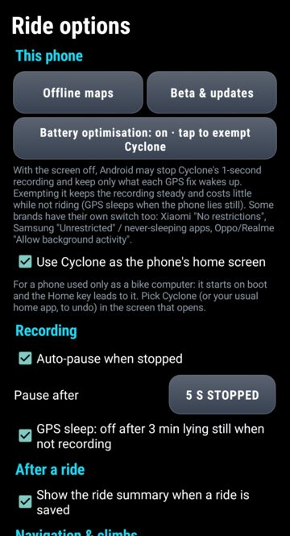

---

## 2. The home screen

The home screen shows the clock, the date and the battery. Below that:

- **The Ride card** (the big green card with the round play button). It shows what you're about to ride: the
  route name or **Free ride · no route**, and how many sensors are paired (**GPS only** when none are).
  Tap it to open the ride screen.
- **This week**: rides, km, time and climbing so far this week.
- **Tiles**. Each one opens a screen, and the small line under its name shows what's set up there:
  - **Routes**: import and pick a route.
  - **Workouts**: pick a structured training session.
  - **History**: every finished ride, totals and personal records.
  - **Stats**: goals and how you're doing (from 0.14.0).
  - **Gear**: your bikes (from 0.14.0).
  - **Sensors**: pair heart rate, speed, cadence and power sensors.
  - **Options**: everything else (auto-pause, laps, sounds, rider weight and zones, crash alerts...).
  - **Online**: uploads to Strava and Intervals.icu, and weather data.
- **Round shortcuts**: **Komoot** and **Strava** (greyed out if those apps aren't installed),
  **Settings** (the phone's settings) and **All apps**.

On a small screen, or with the phone's text size turned up, the home screen scrolls: swipe up to reach the
tiles and shortcuts (from 0.14.3).

If you use an old phone only as a bike computer, you can make Cyclone its home screen:
**Options → Use Cyclone as the phone's home screen**. It then starts by itself when the phone boots, and the
Home key brings you back to it. To undo, untick it and pick your usual home app.

---

## 3. Offline map for your area

With an offline map, the map page, street names in turn directions and the way back when you're off course
all work without internet. Without one, the map page loads OpenStreetMap from the internet.

1. **Options → Offline maps** (or tap **Find my map** when Cyclone offers it).
2. Tap **Find maps for my location**. Cyclone lists the maps that cover where you are, with their size.
   You can also type a place in **Or search by name**.
3. Pick the **smallest** map that covers where you ride. Regional maps are about 50 MB to 1 GB.
4. Cyclone shows the size and free space. Tap **Download**.
   - On Wi-Fi it simply downloads. If you drop to mobile data, it pauses and carries on by itself later.
   - On mobile data you choose **Use mobile data** or **Wait for Wi-Fi**.
5. Progress shows on the screen and in the notification shade.

Under **On this phone** you see the maps you have. When a newer build of a map is out, its button turns
green: tap it to update. Long-press a map twice to delete it.

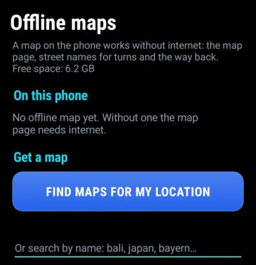

### Routing data

To find the way back when you leave a route, Cyclone also needs **routing data** for the area (about
40 MB for each square of 5° × 5°). It downloads by itself on Wi-Fi when you pick a route. On mobile data,
open **Routes** and press the **Download ... now** button under **Offline routing**. See [section 6](#6-routes).

---

## 4. Pairing sensors

Cyclone works with GPS alone, but it can also use one sensor of each kind: **Heart rate**, **Speed**,
**Cadence** and **Power**. It pairs over **Bluetooth** (every phone) or **ANT+** (many Samsung and Sony phones
have it built in). The top of the Sensors screen tells you which ones your phone has.

1. Tap **Sensors** on the home screen.
2. Wake the sensor: spin the wheel or the crank, or put the heart rate strap on.
3. Tap **Pair** under the sensor type.
   - **Bluetooth**: a list opens with the sensors it finds, nearest first ("very close", "near", "far").
     Tap yours. The first time, Android 12 and newer ask for the **Nearby devices** permission; allow it.
   - **ANT+**: if your phone has ANT+, tap **ANT+ search** in that list and follow the ANT+ screen.
4. The line under the sensor type now shows its name, and for Bluetooth sensors the battery level.

The other buttons:

- **Forget** removes the pairing for that sensor type.
- **Wheel circumference (mm)** and **Save**: the distance one turn of the wheel covers. Speed from a wheel sensor
  depends on it. 700×25C is 2105, 700×28C is 2136. From 0.14.0 each bike in **Gear** keeps its own tyre size,
  so set it there instead.

Good to know:

- A combined speed/cadence sensor fills both fields.
- A power meter gives cadence too when no cadence sensor is paired.
- During a ride Cyclone reconnects lost sensors by itself.

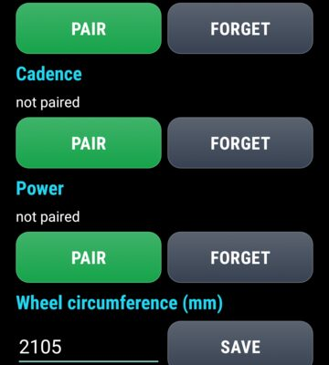

---

## 5. Riding

Tap the **Ride** card on the home screen. The ride screen stays on and also shows over the lock screen.

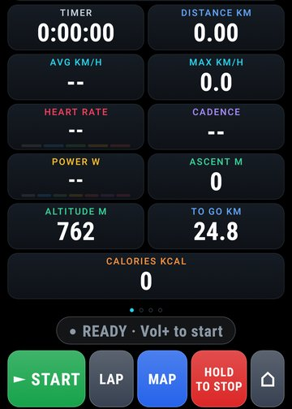

### The buttons at the bottom

From left to right:

| Button | What it does |
|---|---|
| **► Start** (green) | Starts the ride. While recording it turns into **❚❚ Pause**; when paused it says **► Resume**. |
| **Lap** | Starts a new lap. Each lap shows in the summary afterwards. |
| **Map** (blue) | Goes to the next page. The label is the page it goes to: Map → Climb → Ahead → Data. |
| **Hold to stop** (red) | Stops and saves the ride. **Hold it for 1.5 seconds**; a white bar fills the button. Letting go early cancels, so a bump won't end your ride. |
| **⌂** | Back to the home screen. A ride keeps recording in the background. |

### The volume keys

The volume keys work even with gloves on or rain on the screen:

| Key | What it does |
|---|---|
| **Vol+** | Start the ride. Pressed again: pause. Again: resume. |
| **Vol−** (short press) | Next page (Data → Map → Climb → Ahead). |
| **Vol−** (hold) | Stop and save the ride. |

The keys only work while the screen is on.

### The banner

The bar above the buttons tells you what's happening:

- **READY · Vol+ to start**: nothing is being recorded yet.
- **RIDE RESUMED · ride on** (or **· Vol+ to go** if the ride was paused): Cyclone or the phone restarted in
  the middle of a ride, and the same ride carries on.
- **RECORDING** (with **LAP 2**, **LAP 3**... after a lap). **no GPS yet** means it's still waiting for a GPS fix.
- **PAUSED · Vol+ to resume**: you paused it yourself.
- **AUTO-PAUSE**: you stopped moving, so the timer has stopped. It carries on by itself when you ride off.
- **OFF COURSE**: you left your route (see [section 6](#6-routes)).

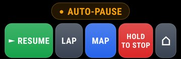

### The four pages

- **Data**: timer, distance, average and top speed, heart rate, cadence, power, ascent, altitude, distance
  to go on a route, and calories. Heart rate and power are coloured by zone once your zones are set
  (Options → Rider & zones). Without a speed sensor, speed comes from GPS and is worked out the way
  Strava does it (distance over the last 5 seconds), so it settles a few seconds after you stop and
  matches what Strava shows later.
- **Map**: your position, the route and the ride so far. Buttons on the map:
  **+** and **−** zoom, **◎** follows your position again after you've moved the map,
  **N / ▲** switches between north up (**N**) and the map turning with your direction (**▲**), and the
  small button with the map name switches between **Offline**, **OSM** and **CyclOSM**.
- **Climb**: altitude, grade, VAM and ascent, plus the height profile ahead coloured by steepness, and a card
  for the climb you're on or the next one. Climbs *ahead* need a route with elevation. Without a route
  Cyclone still notices the climb you're on and sums it up at the top.
- **Ahead**: temperature, rain chance and wind (head, tail or side wind on a route), the weather forecast
  along the route at the time you'll get there, and stops along the route such as water, minimarkets,
  fuel, mosques, toilets, bike shops and medical. This page needs to have been online once
  before the ride (Wi-Fi or a hotspot is enough).

### Small screens and large text (from 0.14.3)

Every number and label on the ride screen takes the largest size that fits its box, so nothing is cut off on
a small phone, and numbers grow a little on a tablet. Cyclone follows the phone's **Font size** setting up to
1.3 times the normal size; beyond that, the ride screen would run out of room for the numbers.

### Day and night colours (from 0.14.1)

Cyclone has two looks: **Day** (black on white, the easiest to read in direct sunlight) and **Night**
(white on black, easy on the eyes after dark and on the battery of AMOLED screens). With **Auto**, the
default, it switches at sunrise and sunset where you are, or at 06:00 and 18:00 until the phone knows
where you are. Every screen follows it.

- **Tap the clock** at the top left of the ride screen to change it while riding: Auto → Day → Night.
- Or set it in **Options → Colours**.

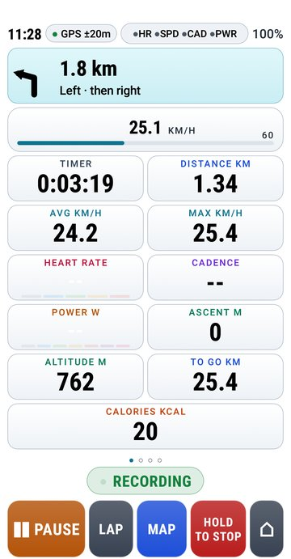&nbsp;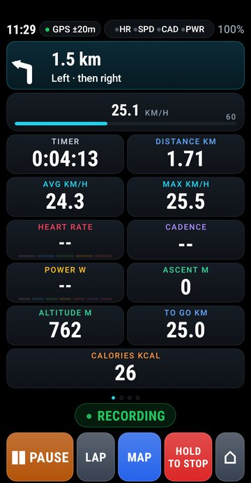

### Auto-pause, GPS sleep and screen-off recording

- **Auto-pause** stops the timer when you stand still for a few seconds (5 s by default) and starts it again
  when you move. Change or turn it off in **Options → Recording**.
- **GPS sleep**: when you're not recording and the phone lies still for 3 minutes, GPS switches off to save
  battery. It wakes up when you pick the phone up.
- **Screen off**: the ride keeps recording once a second with the screen off, as long as Cyclone is
  exempt from battery optimisation (see [section 1](#stop-android-from-cutting-your-recording)).
- If the phone or Cyclone restarts in the middle of a ride, the same ride carries on when Cyclone opens again.

---

## 6. Routes

Tap **Routes** on the home screen.

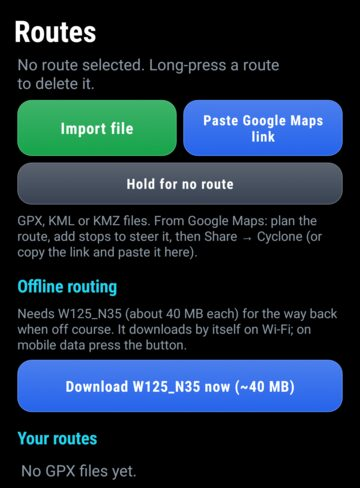

### Getting a route in

- **From a file**: tap **Import file** and pick a GPX, KML or KMZ file (from Komoot, RideWithGPS, Google My
  Maps, Google Earth...). You can also use **Open with** or **Share** in another app (Files, WhatsApp...)
  and choose Cyclone.
- **From Google Maps**:
  1. Plan the route in Google Maps. Any mode works, and two-wheeler or motorbike mode works well.
  2. A start and a destination are enough. Add stops to steer the route along the roads you want.
  3. Tap **Share** and pick **Cyclone route**. Or copy the link, open Routes in Cyclone and tap
     **Paste Google Maps link**.

  Google's link carries your stops but not its own line, so Cyclone draws a bike route through your
  stops. Check it on the map before you ride.

### Picking a route

- Tap a route under **Your routes** to ride it. It turns green with a ✓, and the screen shows its length
  and climbing.
- **Hold for no route**: hold this button to ride without a route (a "free ride").
- To delete a route, long-press it, then long-press it again within 3 seconds.

### On the road

- **Turn-by-turn**: a strip with an arrow, the distance and the street name (from the offline map),
  with a beep about 250 m before the turn (400 m when you're fast) and at the turn. You can switch
  this off in **Options → Turn-by-turn on routes**.
- **Climb calls**: about 500 m before each climb you get its length, grade and height gain, then the distance
  and metres to the top while you're on it.
- **Spoken directions**: **Options → Speak directions and climb calls** reads them out with the phone's voice.
- **Off course**: more than 50 m off the route for 5 seconds sets off an alarm (repeated every 30 s). Cyclone
  then finds the way back offline and draws it on the map in blue. While you follow that way back, the banner
  says **DETOUR** and the alarm stays quiet. This needs the routing data under **Offline routing** on the
  Routes screen.

---

## 7. Workouts

Tap **Workouts** on the home screen.

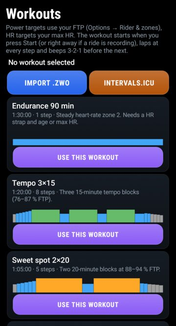

1. Set your **FTP** and **age or max HR** first in **Options → Rider & zones** (and tap **Save rider**).
   Power targets use your FTP, heart rate targets use your max HR.
2. Pick a session and tap **Use this workout**. There are six built-in sessions (endurance, tempo,
   sweet spot, threshold, VO2max, sprints).
3. The workout starts when you start the ride (or straight away if you're already recording). Each step
   gets its own lap, and Cyclone beeps 3-2-1 before the next step. The data page shows the step, the time
   left and the target: **▲** push harder, **▼** ease off, **✓** on target.
4. **Stop workout** ends it. The ride itself goes on.

More workouts:

- **Import .zwo**: a Zwift workout file.
- **Intervals.icu**: fetches your planned workouts for the next 7 days. Connect Intervals.icu on the
  **Online** screen first (see [section 8](#strava-and-intervalsicu)).

---

## 8. After the ride

### The summary

When you stop a ride (**Hold to stop** or hold **Vol−**), the summary opens by itself. It shows the totals,
the track, elevation, speed, heart rate and power over distance, time in each zone, best efforts, climbs
and laps.

At the top, from 0.15.0, the **Insights** card tells you how the ride went in a few sentences: what kind of
ride it was (the label, for example **Endurance · Rolling · 38 km**), what shaped it, and what to take from
it. Under that come up to seven notes, each with a line on what it means:

- **Bests**: a new fastest 5, 10, 20, 40 or 100 km, new best power, your longest ride or most climbing.
- **Compared with you**: your average speed against your earlier rides of a similar distance, and how many
  rides and km you did in the last 30 days.
- **Pacing**: the first half against the second, and the reason when one was slower: more climbing, or the
  wind.
- **Wind and temperature** at the time of the ride, from Open-Meteo, once the phone is online (the first
  time you open a ride it may take a few seconds). Only an approximate spot, rounded to about 1 km, is sent.
- **Effort**, with a heart-rate sensor or power meter: time in zones, training load with a recovery tip,
  and whether your heart rate crept up later in the ride. Set your age or max heart rate (and your FTP for
  power) in **Options → Rider & zones**.
- **Climbs, stops, calories and goals.**

Insights compare a ride only with the rides before it, so an older ride still reads as it did on the day.
Rides shorter than 1 km or 5 minutes are left out of the comparisons.

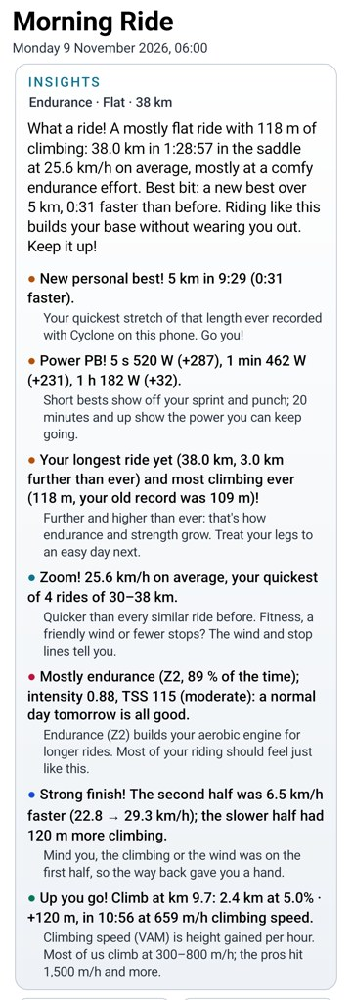

Under the totals, **Altitude** says where the heights came from: the **barometer**, **GPS**, or **terrain
data**. Some phones without a barometer record no usable height at all; from 0.14.1 such a ride gets its
altitude from terrain data (Open-Meteo) as soon as the phone is online, before it goes to Strava or
Intervals.icu, so its elevation is no longer 0 m.

At the bottom, under **Send**:

- **Strava (web)**: see below.
- **Upload**: sends the ride to Strava and/or Intervals.icu (only shown once one of them is connected).
- **Done**: closes the summary.

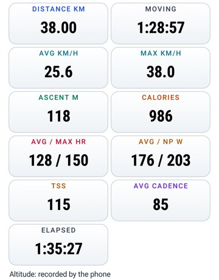

### History

**History** on the home screen shows your totals (this week, month, year and all time), personal records
(longest ride, most climbing, top speed, fastest 5/10/20/40/100 km, best power...) and every ride.
Tap a ride to open its summary again.

### Where the files are

Every ride is saved twice, as a `.fit` file (what Strava, Garmin Connect and Intervals.icu read) and as a
`.gpx` file, in:

`Android/data/io.github.zakusworo.cyclone/files/rides/`

On a few phones Android won't create that folder; Cyclone then keeps rides, routes and maps in its own
internal storage instead (from 0.14.2), and History shows them as usual. Some phones also hide the folder
from file managers. Either way, the **Strava (web)** button below puts a copy of the `.fit` file in
**Download/Cyclone**, which every file manager can see.

### Strava and Intervals.icu

- **Strava (web)**, the easy way:
  1. Tap **Strava (web)** in the summary (or next to a ride on the **Online** screen).
  2. Cyclone saves the ride to **Download/Cyclone** and opens Strava's upload page in your browser.
  3. Log in if needed, tap **Choose Files** and pick the file from Download/Cyclone.

  On Android 8 and 9 the button asks once for storage access (from 0.14.0). Allow it.
- **Intervals.icu** (free): on the **Online** screen, enter your **Athlete ID** and **API key** (from
  intervals.icu → Settings → Developer Settings) and tap **Save + pull FTP**. New rides then upload by
  themselves, and your FTP comes over from Intervals.icu.
- **Strava automatic upload** is only possible with your own Strava API app (Client ID and Client Secret on
  the **Online** screen, then **Connect**). Strava now needs a subscription to create one, so most people
  use **Strava (web)**.

The **Online** screen also has **Sync now**. Cyclone syncs by itself every 30 minutes and right after a
ride, whenever there's a connection.

---

## 9. Gear (from 0.14.0)

**Gear** keeps your bikes. Each bike has its own tyre size (for speed from a wheel sensor), its own speed
and cadence sensors, and its own km. Heart rate and power sensors stay with you, whichever bike you ride.

Your settings from before 0.14.0 become your first bike automatically, so nothing changes until you open Gear.

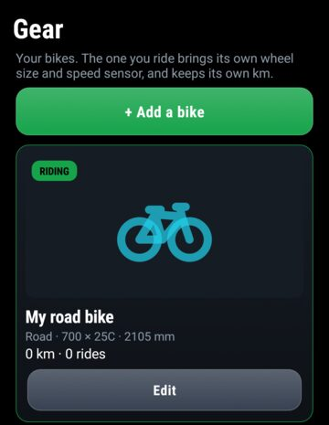

- **+ Add a bike**: opens the bike form. Only the **Type** is needed (Road, Gravel, Mountain, Folding,
  City / hybrid, E-bike, Touring, BMX, Kids, Other). Everything else is optional:
  - **Take photo** or **Choose photo** for the bike's picture.
  - **Nickname**, **Brand** and **Model** (pick from the list, or type your own).
  - **Tyre size**: pick the size printed on the tyre, or **Custom (type the mm)...** for a measured
    circumference.
  - **Year**, **Weight kg** and **Km before Cyclone**.
  - The tick box **Suggest this brand / model for Cyclone's list** sends only the brand, model, year and type.
  - Tap **Save**.
- **Ride this bike**: makes that bike the one you ride. It gets the **RIDING** badge, and its tyre size and
  sensors are used. Switch before the ride, not during it.
- **Edit**: change a bike. **Hold to delete this bike** removes it (you always keep at least one).

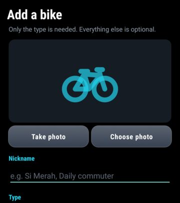

---

## 10. Stats & goals (from 0.14.0)

Tap **Stats** on the home screen.

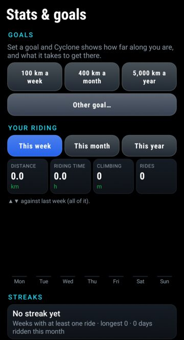

- **Goals**: tap a ready-made goal (**100 km a week**, **400 km a month**, **5,000 km a year**) or
  **Other goal...** to pick distance, riding time, climbing or rides, per week, month or year. You can have up
  to four goals (**+ Add a goal**). Each one shows a progress ring and what you still need, for example
  "18 km a day for 6 days". Hold a goal to remove it.
- **Your riding**: tap **This week**, **This month** or **This year** to see distance, riding time, climbing
  and rides, compared with the whole of the period before (▲ more, ▼ less), and a bar chart.
- **Streaks**: how many weeks in a row you've ridden at least once.
- **By bike**: km per bike in the chosen period.

The **Stats** tile on the home screen shows your first goal.

---

## 11. Options worth knowing

**Options** on the home screen holds the rest. Changes save by themselves, except where there's a Save button.

- **Recording**: **Auto-pause when stopped**, **Pause after** (3 to 15 s), **GPS sleep**.
- **After a ride**: **Show the ride summary when a ride is saved**.
- **Navigation & climbs**: **Turn-by-turn on routes**, **Climb calls**, **Speak directions and climb calls**.
- **Laps**: **Auto-lap every** 1 to 50 km, or a lap each time a loop passes the start point.
- **Reminders**: **Eat every** and **Drink every** so many minutes of riding.
- **Rider & zones**: weight, bike + bags, age, sex, max HR, FTP, target heart rate and power zones, cadence
  range. Used for calories, zones and workouts. Tap **Save rider**.
- **Zone alerts**: a warning when heart rate or power stays outside your target zone.
- **Sounds**: for start, stop, lap, eat, drink, zone high and zone low. Tap the choice to switch between
  **Anime voice**, **Beep**, **Custom file** and **Off**. **►** plays it, **File** picks your own sound.
- **Colours** (from 0.14.1): **Auto**, **Day** or **Night**, see [Day and night colours](#day-and-night-colours-from-0141).
- **Battery saver**: dims the ride screen and lets it turn off with the phone's screen timeout. GPS then
  updates every 2 s. Laps, reminders, alerts and going off course turn the screen back on. The volume
  keys don't work while the screen is off.
- **Crash detection**: after a hard jolt while riding and then 30 seconds without moving, a 30-second alarm
  starts with a big **I'M OK** button (any volume key also cancels it). If you don't cancel it, a message with
  your location goes to your contact through **ntfy** (free, no account) or a **Telegram** bot. It needs
  internet, not SMS. Fill in the fields, tap **Save**, then **Send test** to check.

---

## 12. Updates and problem reports

### Updates

Cyclone checks for a new beta twice a day and shows a notification. Tap it to download and install.
Android asks you to confirm, and the first time to allow Cyclone to install apps. Your rides and settings
are kept.

To check by hand: **Options → Beta & updates**, then tap **Check & update**. If there's a new version it
downloads and installs straight away. When you're up to date the button says **Up to date · check again**.

The same screen shows **Messages** from the developer.

### Something went wrong

- **Cyclone closed by itself or froze**: tap the "Cyclone closed unexpectedly" notification, or go to
  **Options → Beta & updates → Send problem report**. Your e-mail app opens, addressed to Cyclone support
  (cyclonebikeco@gmail.com) with the report attached. Press Send. The report holds Cyclone's own log, phone
  model, app version and the active route's name, not your rides. Nothing is sent until you press Send.
  You can send a report without a crash too. Hold **Clear** to delete recorded problems without sending.
- **Anything else**: tap **Report on GitHub** on the same screen (it opens a new issue with your phone details
  filled in), or **Copy phone details** and paste them into an
  [issue](https://github.com/zakusworo/cyclone-beta/issues/new). Say what you did, what happened and what
  you expected. A ride's `.fit` file helps a lot: open the ride in **History**, tap **Strava (web)**, and
  the file lands in **Download/Cyclone**, ready to attach.

---

## 13. Troubleshooting

**"There was a problem parsing the package" when installing.**
The download is incomplete or isn't the app. Delete it and download again, on Wi-Fi if you can. On the
Releases page, take `cyclone.apk`, not "Source code".

**Cyclone closes when I press Start.**
Update to 0.14.2 or newer. On some phones Android wouldn't create Cyclone's storage folder; Cyclone now uses
its own storage instead. If Start still fails, you'll see a message: send a problem report from
**Options → Beta & updates**.

**Numbers on the ride screen are cut in half, or a button label is cut short.**
Update to 0.14.4. Before 0.14.3, small screens and large text sizes cut the numbers off and the red button read
"HOLD TO"; before 0.14.4, the green button could show only ► on Android 8. If something is still cut off,
send a screenshot from **Options → Beta & updates → Report on GitHub**.

**The recorded track has gaps or straight lines.**
Cyclone isn't exempt from battery optimisation. See [section 1](#stop-android-from-cutting-your-recording),
including the brand's own switch.

**The map page is empty or says "No offline map installed, using OSM".**
You have no offline map and no internet. Download a map in **Options → Offline maps**.

**My sensor isn't found.**
Wake it (spin the wheel or crank, wear the strap, and moisten a heart rate strap). Check that Bluetooth is on
and that Cyclone has the **Nearby devices** permission. An ANT+-only sensor needs a phone with ANT+ and
the **ANT+ search** button. Many Bluetooth sensors connect to only one app at a time, so close other
cycling apps.

**Speed from my wheel sensor is wrong.**
Set the right tyre size: in **Gear → Edit** from 0.14.0, otherwise in **Sensors → Wheel circumference (mm)**.

**My distance is shorter (or longer) than my watch or another bike computer.**
A phone's GPS is not as good as a dedicated unit's, and each device smooths its track differently, so 2–3 %
is normal. Before 0.14.1, Cyclone read about 10 % short without a speed sensor; update if you are on an older
version. A wheel speed sensor with the right tyre size gives the most exact distance.

**Strava shows 0 m elevation.**
Update to 0.14.1 or newer: rides recorded without altitude then get it from terrain data before they are
sent. For a ride already on Strava, open it on strava.com and look for **Correct Elevation** in the **…** menu.

**The volume keys do nothing.**
The screen has to be on and the ride screen open. With **Battery saver** on, the screen may have timed out.

**No climbs ahead.**
Climbs ahead need a route with elevation. Without a route you only get the climb you're on.

**No way back when I'm off course.**
The routing data for that area is missing. Open **Routes** and tap the **Download ... now** button under
**Offline routing** (about 40 MB).

**The Ahead page says "No forecast yet".**
The forecast and stops download when the phone is online. Connect to Wi-Fi or a hotspot once before the ride.

**Strava (web) on Android 8 or 9 says it can't save.**
Allow storage access when Cyclone asks (from 0.14.0).
